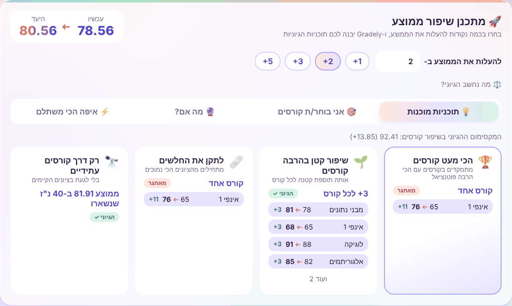
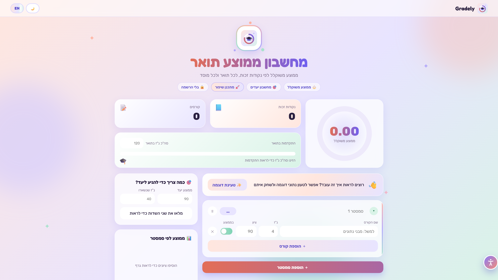
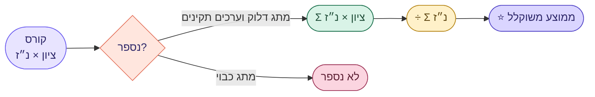

<div dir="rtl">

<p align="center">
  <a href="https://noyaadivi.github.io/gradely/"></a>
</p>

<p align="center"><a href="README.md"></a></p>

<p align="center">
  <a href="https://noyaadivi.github.io/gradely/"></a>
  <a href="#how-it-works"></a>
  <a href="#run-locally"></a>
</p>

<p align="center">
  <a href="LICENSE"></a>
  <a href="https://github.com/NoyaAdivi/gradely/commits/main"></a>
  <a href="https://github.com/NoyaAdivi/gradely"></a>
</p>

<h3 align="center">לדעת איפה התואר שלך עומד, במבט אחד.</h3>

<p align="center">
  Gradely הוא מחשבון ממוצע משוקלל לפי נקודות זכות, בעברית ובאנגלית, לכל תואר ולכל מוסד.<br>
  מוסיפים סמסטרים, רואים את הממוצע מתעורר לחיים, מגלים בדיוק מה צריך כדי להגיע ליעד,<br>ונותנים ל<b>מתכנן השיפור</b> להראות את הדרך הכי חכמה להעלות את הממוצע.
</p>

<table align="center">
  <tr>
    <td align="center" width="20%"><a href="#how-it-works"><b>⚖️ משוקלל</b></a><br><sub>לפי נ"ז, כמו שצריך</sub></td>
    <td align="center" width="20%"><a href="https://noyaadivi.github.io/gradely/"><b>🎯 יעדים</b></a><br><sub>מה צריך כדי להגיע</sub></td>
    <td align="center" width="20%"><a href="#boost-planner"><b>🚀 שיפור</b></a><br><sub>תוכניות חכמות להעלאת הממוצע</sub></td>
    <td align="center" width="20%"><a href="README.md"><b>🌍 HE · EN</b></a><br><sub>דו־לשוני מלא, תומך RTL</sub></td>
    <td align="center" width="20%"><a href="#grade-sheet"><b>📸 גיליון ציונים</b></a><br><sub>העלאה, צילום או הקלדה</sub></td>
  </tr>
</table>

<a name="highlights"></a>
<p align="center"><a href="#see-it-in-action"></a></p>

<table>
  <tr valign="top">
    <td valign="top" width="33%" dir="rtl">
      <p><b>📚 מעקב אחרי התואר</b></p>
      <ul>
        <li><b>סמסטרים</b> שאפשר לתת להם שם, לקפל ולמחוק</li>
        <li><b>ממוצע משוקלל</b> כללי ולכל סמסטר</li>
        <li><b>מתג</b> שמוציא קורס מהממוצע</li>
        <li><b>פס התקדמות</b> לפי סה"כ נ"ז בתואר</li>
      </ul>
    </td>
    <td valign="top" width="33%" dir="rtl">
      <p><b>🎯 תכנון קדימה</b></p>
      <ul>
        <li><b>מחשבון יעד:</b> איזה ממוצע צריך בנ"ז שנשארו</li>
        <li><b>גרף</b> של הממוצע לפי סמסטר, עם קו מקווקו לממוצע הכללי</li>
        <li><b>כל סולם ציונים:</b> 100, 4.0, 5.0, 10 או 20</li>
        <li><b>קונפטי</b> כשכבר הגעת ליעד 🎉</li>
      </ul>
    </td>
    <td valign="top" width="33%" dir="rtl">
      <p><b>💛 נבנה באהבה</b></p>
      <ul>
        <li><b>עברית ואנגלית</b> בלחיצה, RTL ו-LTR</li>
        <li><b>נשמר בדפדפן</b>, בלי הרשמה ובלי שרת</li>
        <li><b>ייצוא וייבוא</b> של הציונים כקובץ JSON</li>
        <li><b>🔗 קישור לשיתוף</b> שפותח את הציונים בכל מכשיר, ו<b>🖨 הדפסה או שמירה כ-PDF</b></li>
        <li><b>📋 הדבקת רשימת קורסים</b> ישר מאקסל או מהפורטל של המוסד</li>
        <li><b><a href="#grade-sheet">📸 גיליון ציונים</a></b> ממסמך, מצילום או בהקלדה</li>
        <li><b>מותאם לנייד</b>, מונפש, ומכבד הגדרת תנועה מופחתת</li>
        <li><b>נתוני דוגמה</b> בלחיצה, ו<b>ביטול</b> אחרי מחיקה (גם Ctrl+Z)</li>
      </ul>
    </td>
  </tr>
</table>

<a name="app"></a>
<h3 align="center">📲 אפליקציה ושאלות נפוצות <sub><sup>חדש</sup></sub></h3>
<p align="center">אפשר להתקין את Gradely כאפליקציה אמיתית עם אייקון משלה, והאתר עונה על השאלות הנפוצות לפי נושא.</p>

<table>
  <tr valign="top">
    <td width="50%">
      <ul>
        <li><b>📲 אפליקציה להתקנה (PWA):</b> אייקון וחלון משלה בטלפון ובמחשב, עם השם Gradely בלבד</li>
        <li><b>⚡ עובדת גם בלי אינטרנט</b> אחרי הביקור הראשון, בעזרת Service Worker</li>
        <li><a href="fx.js"><b>✨ תנועה כיפית</b></a>: האזורים צפים פנימה בגלילה, הכרטיסים נוטים וזוהרים מתחת לעכבר, הכפתורים מגיבים בגל רך והראשיים מתפוצצים בנצנצים פסטליים (הכל נכבה כשמבקשים פחות תנועה)</li>
      </ul>
    </td>
    <td width="50%">
      <ul>
        <li><b><a href="https://noyaadivi.github.io/gradely/?lang=he#faq">❓ שאלות נפוצות לפי נושא</a>:</b> סינון בצ׳יפים, חיפוש עם הדגשה ואנימציות רכות</li>
        <li><b>🔗 נבנה על ידי נויה אדיבי</b> עם קישור ללינקדאין בתחתית כל עמוד</li>
      </ul>
    </td>
  </tr>
</table>


<a name="grade-sheet"></a>
<h3 align="center">📸 מילוי ציונים מגיליון הציונים <sub><sup>חדש</sup></sub></h3>
<p align="center">לא צריך להקליד כל קורס. בוחרים אחת משלוש דרכים ו־Gradely ממלא את השמות, הנקודות והציונים לבד.</p>
<table>
  <tr valign="top">
    <td width="33%" align="center"><b>📄 העלאת מסמך</b><br><sub>PDF, Word, Excel, CSV או תמונה. PDF סרוק נקרא עמוד אחרי עמוד</sub></td>
    <td width="33%" align="center"><b>📷 צילום הגיליון</b><br><sub>נפתחת המצלמה האחורית של הטלפון, זיהוי טקסט בעברית ובאנגלית</sub></td>
    <td width="33%" align="center"><b>✍️ הקלדה ידנית</b><br><sub>או הדבקת טקסט ישר מהפורטל של המוסד</sub></td>
  </tr>
</table>
<ul>
  <li><b>✅ בודקים לפני ששומרים:</b> חלון בדיקה שבו מתקנים כל שדה, מדלגים על קורסים ובוחרים לאן הם נכנסים, ואחרי ההוספה יש כפתור <b>ביטול</b></li>
  <li><b>🗂️ שומר על הסמסטרים:</b> כותרות כמו "סמסטר א' תשפ"ה" בקובץ הופכות לסמסטרים נפרדים</li>
  <li><b>🧠 קריאה חכמה:</b> מדלג על קודי קורס, תאריכים ושורות ממוצע. קורס עובר או פטור נספר בנקודות אבל לא בממוצע</li>
  <li><b>⚖️ הסולם הנכון:</b> גיליון בסולם 0 עד 100 מחליף את סולם הציונים לבד</li>
  <li><b>🔒 פרטי:</b> הכל קורה בדפדפן והקובץ לא נשלח לשום מקום. עובד גם בגרירה או ב־Ctrl+V</li>
</ul>
<p align="center"><sub>הקוד: <a href="scan.js">scan.js</a>. כלי הקריאה (<a href="https://github.com/naptha/tesseract.js">Tesseract.js</a>, <a href="https://github.com/mozilla/pdf.js">PDF.js</a>, <a href="https://github.com/mwilliamson/mammoth.js">Mammoth</a>, <a href="https://github.com/SheetJS/sheetjs">SheetJS</a>) נטענים רק כשבוחרים קובץ.</sub></p>

<a name="boost-planner"></a>
<h3 align="center">🚀 מתכנן שיפור ממוצע <sub><sup>חדש</sup></sub></h3>
<p align="center">בוחרים בכמה נקודות רוצים להעלות את הממוצע, ו-Gradely בונה תוכניות הגיוניות להגיע לשם.</p>

<table dir="rtl">
  <tr valign="top">
    <td width="50%" dir="rtl">
      <ul>
        <li><b>💡 תוכניות מוכנות:</b> הכי מעט קורסים, שיפור קטן בהרבה קורסים, לתקן את החלשים, או רק דרך קורסים עתידיים</li>
        <li><b>⚖️ גבולות הגיוניים:</b> קובעים מה הציון המקסימלי ההגיוני וכמה אפשר לשפר בכל קורס</li>
        <li><b>🏷️ תגיות</b> שמראות אם התוכנית הגיונית או מאתגרת</li>
      </ul>
    </td>
    <td width="50%" dir="rtl">
      <ul>
        <li><b>🎯 בחירה ידנית:</b> בוחרים על אילו קורסים לחזור ורואים איזה ציון צריך בכל אחד</li>
        <li><b>🔮 מה אם?</b> מזיזים ציון חדש לכל קורס ורואים את הממוצע משתנה בזמן אמת</li>
        <li><b>⚡ איפה הכי משתלם:</b> דירוג של הקורסים שהכי מזיזים את הממוצע</li>
      </ul>
    </td>
  </tr>
</table>

<p align="center"><a href="https://noyaadivi.github.io/gradely/#boost"></a></p>

<a name="see-it-in-action"></a>
<p align="center"><a href="#how-it-works"></a></p>

<p align="center">
  <a href="https://noyaadivi.github.io/gradely/"></a>
</p>

<a name="how-it-works"></a>
<p align="center"><a href="#tech-stack"></a></p>



| מה | נוסחה |
|---|---|
| ממוצע משוקלל | `Σ (grade × credits) / Σ credits` |
| ממוצע סמסטר | אותה נוסחה, רק על הקורסים של הסמסטר |
| מה צריך ליעד | `(goal × (credits + left) − Σ grade × credits) / left` |
| שיפור ב-X נקודות | מוצאים שיפורי ציונים שמוסיפים `X × Σ credits` ל-`Σ grade × credits`, כל אחד בתוך הגבולות ההגיוניים |
| כמה קורס שווה | כל נקודה בקורס מוסיפה לממוצע `credits / Σ credits` |

<p align="center"><sub>קורס נספר רק כשהציון בתוך הסולם, הנ"ז חיוביות והמתג דלוק.</sub></p>

<a name="tech-stack"></a>
<p align="center"><a href="#run-locally"></a></p>

<p align="center">
<a href="https://developer.mozilla.org/docs/Web/HTML"></a>
<a href="https://developer.mozilla.org/docs/Web/CSS"></a>
<a href="https://developer.mozilla.org/docs/Web/JavaScript"></a>
<a href="https://pages.github.com"></a>
</p>

<a name="run-locally"></a>
<p align="center"><a href="#contact"></a></p>

1. משכפלים את הריפו:
   ```bash
   git clone https://github.com/NoyaAdivi/gradely.git
   ```
2. פותחים את `index.html` בדפדפן. זהו ✨

<details>
<summary><b>📂 מבנה הפרויקט</b></summary>

```
├── index.html        מבנה הדף והתבניות
├── style.css         עיצוב פסטלי ואנימציות
├── fx.js             כניסה בגלילה, הטיית כרטיסים, גלים ונצנצים
├── app.js            חישובים, החלפת שפה ושמירה
├── scan.js           קריאת גיליון ציונים (צילום, PDF, Word, Excel, טקסט)
├── faq.js            שאלות ותשובות לפי נושא
├── sw.js             עבודה בלי אינטרנט והתקנה כאפליקציה
├── logo.svg          הלוגו של Gradely
└── docs/
    ├── readme/       באנרים מונפשים ל-README
    └── images/       צילומי מסך
```
</details>

<a name="contact"></a>
<p align="center"><a href="https://www.linkedin.com/in/noya-adivi/"></a></p>

<p align="center">
  <a href="https://noyaadivi.github.io/gradely/"></a>
  <a href="https://www.linkedin.com/in/noya-adivi/"></a>
  <a href="https://noyaadivi.github.io/noya-website"></a>
  <a href="https://github.com/NoyaAdivi"></a>
</p>

</div>
