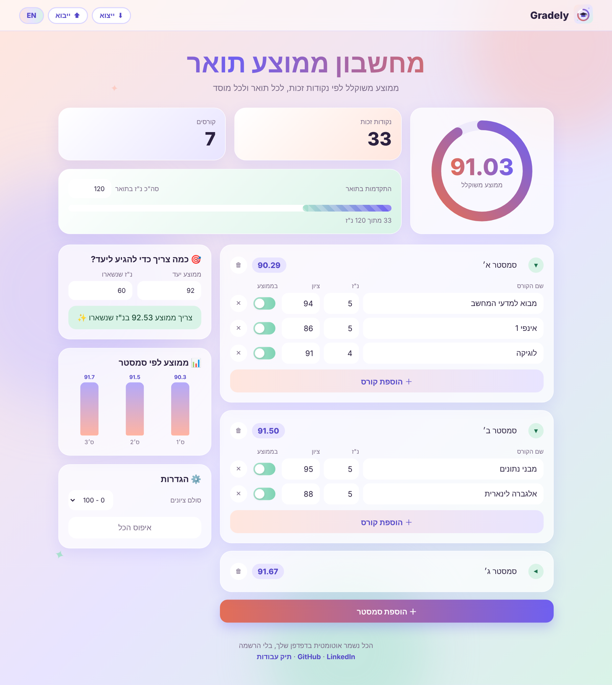
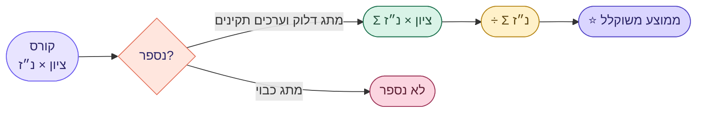

<div dir="rtl">

<p align="center">
  <a href="https://noyaadivi.github.io/gradely/"></a>
</p>

<p align="center"><a href="README.md"></a></p>

<p align="center">
  <a href="https://noyaadivi.github.io/gradely/"></a>
  <a href="#how-it-works"></a>
  <a href="#run-locally"></a>
</p>

<p align="center">
  <a href="LICENSE"></a>
  <a href="https://github.com/NoyaAdivi/gradely/commits/main"></a>
  <a href="https://github.com/NoyaAdivi/gradely"></a>
</p>

<h3 align="center">לדעת איפה התואר שלך עומד, במבט אחד.</h3>

<p align="center">
  Gradely הוא מחשבון ממוצע משוקלל לפי נקודות זכות, בעברית ובאנגלית, לכל תואר ולכל מוסד.<br>
  מוסיפים סמסטרים, רואים את הממוצע מתעורר לחיים, ומגלים בדיוק מה צריך כדי להגיע ליעד.
</p>

<table align="center">
  <tr>
    <td align="center" width="25%"><a href="#how-it-works"><b>⚖️ משוקלל</b></a><br><sub>לפי נ"ז, כמו שצריך</sub></td>
    <td align="center" width="25%"><a href="https://noyaadivi.github.io/gradely/"><b>🎯 יעדים</b></a><br><sub>מה צריך כדי להגיע</sub></td>
    <td align="center" width="25%"><a href="README.md"><b>🌍 HE · EN</b></a><br><sub>דו לשוני מלא, תומך RTL</sub></td>
    <td align="center" width="25%"><a href="#tech-stack"><b>📦 0 ספריות</b></a><br><sub>HTML, CSS, JS בלבד</sub></td>
  </tr>
</table>

<a name="highlights"></a>
<p align="center"><a href="#see-it-in-action"></a></p>

<table>
  <tr valign="top">
    <td valign="top" width="33%" dir="rtl">
      <p><b>📚 מעקב אחרי התואר</b></p>
      <ul>
        <li><b>סמסטרים</b> שאפשר לתת להם שם, לקפל ולמחוק</li>
        <li><b>ממוצע משוקלל</b> כללי ולכל סמסטר</li>
        <li><b>מתג</b> שמוציא קורס מהממוצע</li>
        <li><b>פס התקדמות</b> לפי סה"כ נ"ז בתואר</li>
      </ul>
    </td>
    <td valign="top" width="33%" dir="rtl">
      <p><b>🎯 תכנון קדימה</b></p>
      <ul>
        <li><b>מחשבון יעד:</b> איזה ממוצע צריך בנ"ז שנשארו</li>
        <li><b>גרף</b> של הממוצע לפי סמסטר</li>
        <li><b>כל סולם ציונים:</b> 100, 4.0, 5.0, 10 או 20</li>
        <li><b>קונפטי</b> כשכבר הגעת ליעד 🎉</li>
      </ul>
    </td>
    <td valign="top" width="33%" dir="rtl">
      <p><b>💛 נבנה באהבה</b></p>
      <ul>
        <li><b>עברית ואנגלית</b> בלחיצה, RTL ו-LTR</li>
        <li><b>נשמר בדפדפן</b>, בלי הרשמה ובלי שרת</li>
        <li><b>ייצוא וייבוא</b> של הציונים כקובץ JSON</li>
        <li><b>מותאם לנייד</b>, מונפש, ומכבד הגדרת תנועה מופחתת</li>
      </ul>
    </td>
  </tr>
</table>

<a name="see-it-in-action"></a>
<p align="center"><a href="#how-it-works"></a></p>

<p align="center">
  <a href="https://noyaadivi.github.io/gradely/"></a>
</p>

<a name="how-it-works"></a>
<p align="center"><a href="#tech-stack"></a></p>



| מה | נוסחה |
|---|---|
| ממוצע משוקלל | `Σ (grade × credits) / Σ credits` |
| ממוצע סמסטר | אותה נוסחה, רק על הקורסים של הסמסטר |
| מה צריך ליעד | `(goal × (credits + left) − Σ grade × credits) / left` |

<p align="center"><sub>קורס נספר רק כשהציון בתוך הסולם, הנ"ז חיוביות והמתג דלוק.</sub></p>

<a name="tech-stack"></a>
<p align="center"><a href="#run-locally"></a></p>

<p align="center">
<a href="https://developer.mozilla.org/docs/Web/HTML"></a>
<a href="https://developer.mozilla.org/docs/Web/CSS"></a>
<a href="https://developer.mozilla.org/docs/Web/JavaScript"></a>
<a href="https://pages.github.com"></a>
</p>

<a name="run-locally"></a>
<p align="center"><a href="#contact"></a></p>

1. משכפלים את הריפו:
   ```bash
   git clone https://github.com/NoyaAdivi/gradely.git
   ```
2. פותחים את `index.html` בדפדפן. זהו ✨

<details>
<summary><b>📂 מבנה הפרויקט</b></summary>

```
├── index.html        מבנה הדף והתבניות
├── style.css         עיצוב פסטלי ואנימציות
├── app.js            חישובים, החלפת שפה ושמירה
├── logo.svg          הלוגו של Gradely
└── docs/
    ├── readme/       באנרים מונפשים ל-README
    └── images/       צילומי מסך
```
</details>

<a name="contact"></a>
<p align="center"><a href="https://www.linkedin.com/in/noya-adivi/"></a></p>

<p align="center">
  <a href="https://noyaadivi.github.io/gradely/"></a>
  <a href="https://www.linkedin.com/in/noya-adivi/"></a>
  <a href="https://noyaadivi.github.io/noya-website"></a>
  <a href="https://github.com/NoyaAdivi"></a>
</p>

</div>
