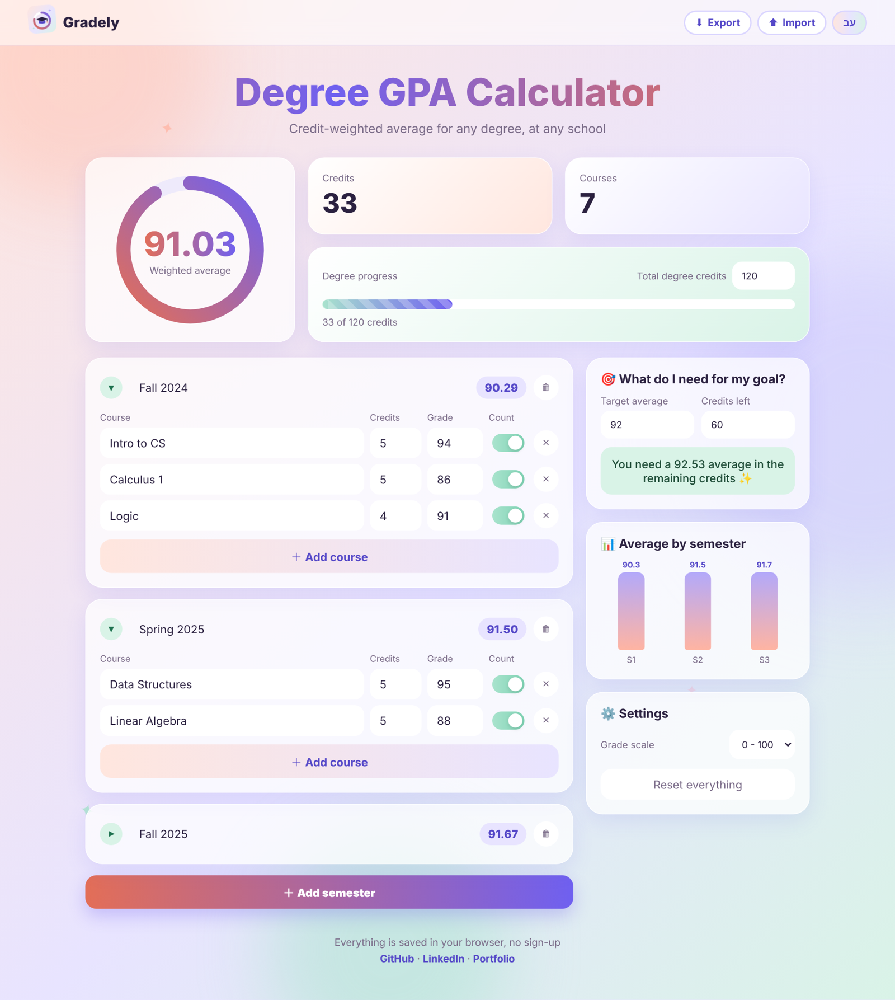
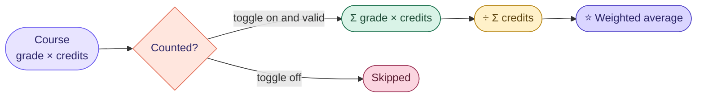

<p align="center">
  <a href="https://noyaadivi.github.io/gradely/"></a>
</p>

<p align="center"><a href="README.he.md"></a></p>

<p align="center">
  <a href="https://noyaadivi.github.io/gradely/"></a>
  <a href="#how-it-works"></a>
  <a href="#run-locally"></a>
</p>

<p align="center">
  <a href="LICENSE"></a>
  <a href="https://github.com/NoyaAdivi/gradely/commits/main"></a>
  <a href="https://github.com/NoyaAdivi/gradely"></a>
</p>

<h3 align="center">Know where your degree stands, in one glance.</h3>

<p align="center">
  Gradely is a bilingual, credit-weighted GPA calculator for any degree at any school.<br>
  Add your semesters, see your average come alive, and find out exactly what you need to hit your goal.
</p>

<table align="center">
  <tr>
    <td align="center" width="25%"><a href="#how-it-works"><b>⚖️ Weighted</b></a><br><sub>by credits, the real way</sub></td>
    <td align="center" width="25%"><a href="https://noyaadivi.github.io/gradely/"><b>🎯 Goals</b></a><br><sub>what you need to get there</sub></td>
    <td align="center" width="25%"><a href="README.he.md"><b>🌍 HE · EN</b></a><br><sub>fully bilingual, RTL ready</sub></td>
    <td align="center" width="25%"><a href="#tech-stack"><b>📦 0 deps</b></a><br><sub>plain HTML, CSS, JS</sub></td>
  </tr>
</table>

<a name="highlights"></a>
<p align="center"><a href="#see-it-in-action"></a></p>

<table>
  <tr valign="top">
    <td valign="top" width="33%">
      <p><b>📚 Track your degree</b></p>
      <ul>
        <li><b>Semesters</b> you can name, fold and delete</li>
        <li><b>Credit-weighted average</b> overall and per semester</li>
        <li><b>Toggle</b> any course in or out of the average</li>
        <li><b>Degree progress bar</b> toward your total credits</li>
      </ul>
    </td>
    <td valign="top" width="33%">
      <p><b>🎯 Plan ahead</b></p>
      <ul>
        <li><b>Goal calculator:</b> the average you need in the credits you have left</li>
        <li><b>Chart</b> of your average by semester</li>
        <li><b>Any grade scale:</b> 100, 4.0, 5.0, 10 or 20</li>
        <li><b>Confetti</b> when you already reached your goal 🎉</li>
      </ul>
    </td>
    <td valign="top" width="33%">
      <p><b>💛 Made with care</b></p>
      <ul>
        <li><b>Hebrew and English</b> with one click, RTL and LTR</li>
        <li><b>Saved in your browser</b>, no sign-up, no server</li>
        <li><b>Export and import</b> your grades as a JSON file</li>
        <li><b>Responsive</b>, animated, and respects reduced motion</li>
      </ul>
    </td>
  </tr>
</table>

<a name="see-it-in-action"></a>
<p align="center"><a href="#how-it-works"></a></p>

<p align="center">
  <a href="https://noyaadivi.github.io/gradely/"></a>
</p>

<a name="how-it-works"></a>
<p align="center"><a href="#tech-stack"></a></p>



| What | Formula |
|---|---|
| Weighted average | `Σ (grade × credits) / Σ credits` |
| Semester average | same formula, only that semester's courses |
| Needed for your goal | `(goal × (credits + left) − Σ grade × credits) / left` |

<p align="center"><sub>A course counts only when its grade is inside the scale, its credits are positive and its toggle is on.</sub></p>

<a name="tech-stack"></a>
<p align="center"><a href="#run-locally"></a></p>

<p align="center">
<a href="https://developer.mozilla.org/docs/Web/HTML"></a>
<a href="https://developer.mozilla.org/docs/Web/CSS"></a>
<a href="https://developer.mozilla.org/docs/Web/JavaScript"></a>
<a href="https://pages.github.com"></a>
</p>

<a name="run-locally"></a>
<p align="center"><a href="#contact"></a></p>

1. Clone the repo:
   ```bash
   git clone https://github.com/NoyaAdivi/gradely.git
   ```
2. Open `index.html` in your browser. That's it ✨

<details>
<summary><b>📂 Project structure</b></summary>

```
├── index.html        page layout and templates
├── style.css         pastel theme and animations
├── app.js            calculations, language switch, saving
├── logo.svg          the Gradely logo
└── docs/
    ├── readme/       animated README banners
    └── images/       screenshots
```
</details>

<a name="contact"></a>
<p align="center"><a href="https://www.linkedin.com/in/noya-adivi/"></a></p>

<p align="center">
  <a href="https://noyaadivi.github.io/gradely/"></a>
  <a href="https://www.linkedin.com/in/noya-adivi/"></a>
  <a href="https://noyaadivi.github.io/noya-website"></a>
  <a href="https://github.com/NoyaAdivi"></a>
</p>
